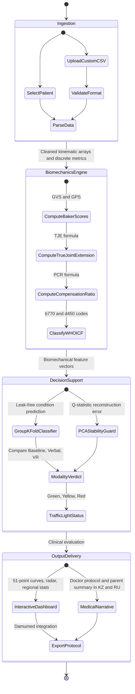

# Libra

Clinical biomechanics and decision support system for pediatric cerebral palsy rehabilitation.

Developed for AI-Sana Shakarim Solveathon: AI & Medicine 2026, Semey, Abai Region.

Libra processes 3D gait data, detects compensatory pelvic tilt during virtual reality motor therapy, isolates true hip joint extension, and generates clinical documentation aligned with World Health Organization International Classification of Functioning codes (ICF b770 and d450).

---

## Clinical statechart



---

## Quick start

### Prerequisites

- Linux, macOS, or Windows
- Python 3.10 or newer and Node.js 18 or newer
- Or Docker and Docker Compose

### Option A: Local startup in one command (Linux / macOS)

Run the startup script from the repository root:

```bash
./run_local.sh
```

The script starts the FastAPI backend on port 8000 and the Next.js frontend on port 3000.

- Web interface: http://127.0.0.1:3000
- REST API documentation (OpenAPI Swagger): http://127.0.0.1:8000/docs
- Health check: http://127.0.0.1:8000/health

To stop both services, press `Ctrl+C`.

### Option B: Windows startup in one command

On Windows using Command Prompt (`cmd`):

```cmd
run_local.bat
```

Or using PowerShell:

```powershell
.\run_local.ps1
```

### Option C: Docker Compose startup (Cross-platform)

To run the containerized production stack with Caddy, FastAPI, and PostgreSQL:

```bash
docker compose up -d --build
```

Access the interface at http://localhost.

---

## Test suite execution

To run all 40 automated tests verifying parsers, biomechanical formulas, leak-free machine learning, and API contracts:

```bash
python3 -m pytest tests/ -v
```

All 40 tests must pass without errors. Tests run against an isolated temporary SQLite database without polluting `libra.db`.

---

## Step-by-step jury evaluation guide

Follow these 9 steps to test the application:

1. **Open the application:** Navigate to http://127.0.0.1:3000 in your browser.
2. **Review the cohort:** Use the patient selector in the upper toolbar. The cohort contains all 29 participants from the hackathon dataset.
3. **Inspect high-risk compensation (Patient `s61520_1`):** Select patient `s61520_1`. Observe that the Clinical Decision Support indicator turns Red. The patient displays a Pathological Compensation Ratio of 1.21. While raw hip extension appears improved by 2.68 degrees, the child achieved this through compensatory pelvic deviation (+5.36 degrees pelvic tilt), yielding TJE = +2.68 degrees and creating risk of lumbar hyperlordosis.
4. **Inspect true therapeutic response (Patient `s61520_13`):** Select patient `s61520_13`. Observe the Green indicator. The patient achieved true joint extension with a Pathological Compensation Ratio under 0.40 without dangerous pelvic tilt.
5. **Compare modalities:** Scroll to the "Selection of rehabilitation tactics" card. The card compares Baseline, Verbal, and VR conditions, stating whether verbal feedback or VR feedback provides the safer outcome for the active patient.
6. **Switch language:** Click the language button in the top navigation bar to toggle between Kazakh (`ҚАЗ`) and Russian (`РУС`). Notice that medical terminology and clinical narratives update across the entire interface.
7. **View regional open data:** Click "Regional data" in the navigation bar. The modal displays epidemiology statistics for Kazakhstan and the Abai Region sourced from `stat.gov.kz` and `data.egov.kz`, showing 2,840 children with disabilities in the region and 0 dedicated 3D gait laboratories in Semey.
8. **Generate clinical report:** Click "Generate report" in the upper right corner. Review the standardized clinical protocol containing WHO ICF codes `b770` and `d450`, metric deltas, and doctor recommendations ready for export to electronic medical record systems like Damumed.
9. **Test custom CSV upload:** Click "Upload CSV" in the top bar. Select or drag any table adhering to the discrete parameter format. The engine validates column headers, parses decimal commas, and displays the analyzed patient card.

---

## Biomechanical formulas and clinical heuristics

### 1. Baker Gait Variable Score (GVS) and Gait Profile Score (GPS)

GVS measures the root mean square deviation of a patient's kinematic curve from the normative mean of typically developing children across 51 points of the gait cycle:

$$GVS_v = \sqrt{ \frac{1}{51} \sum_{t=0}^{50} \left( \theta_{patient, v}(t) - \bar{\theta}_{TD, v}(t) \right)^2 }$$

GPS is the overall index combining all joint variable scores:

$$GPS = \sqrt{ \frac{1}{N_v} \sum_{v=1}^{N_v} GVS_v^2 }$$

*Note: GVS is an unsigned root-mean-square deviation magnitude from the norm corridor, not a directional angle.*

### 2. True Joint Extension (TJE)

Children with cerebral palsy often simulate hip extension by tilting the pelvis anteriorly. True Joint Extension isolates true anatomical joint extension by penalizing compensatory sagittal pelvic tilt ($\Delta PelvicTilt$ derived from kinematic angle curves `aSagP`):

$$TJE = \Delta aMinSagH + \alpha \cdot \max(0, \Delta PelvicTilt)$$

A negative delta indicates true improved anatomical joint extension.

### 3. Pathological Compensation Ratio (PCR)

PCR is a Clinical Decision Support heuristic that quantifies the ratio of kinematic deviation in adjacent segments (pelvis, knee, ankle) relative to hip extension gain:

$$PCR = \frac{0.5 \cdot \max(0, \Delta GVS_P) + 0.3 \cdot \max(0, \Delta GVS_K) + 0.2 \cdot \max(0, \Delta GVS_A)}{|\Delta aMinSagH|}$$

- **Green ($PCR < 0.4$):** True responder. Pure joint improvement.
- **Yellow ($0.4 \le PCR \le 0.8$):** Moderate adaptation. Requires therapist monitoring.
- **Red ($PCR > 0.8$):** Pathological compensation. The engine advises lowering VR target angle by 30 percent.

*The weights ($0.5, 0.3, 0.2$) and decision thresholds ($0.4, 0.8$) are algorithmic heuristics calibrated on the CP cohort to assist clinical evaluation.*

### 4. WHO ICF classification mapping

- **ICF code b770 (Gait pattern functions):** Mapped from GPS:
  - `b770.0` (No impairment): GPS < 5.5 deg
  - `b770.1` (Mild impairment): 5.5 to 7.5 deg
  - `b770.2` (Moderate impairment): 7.5 to 11.0 deg
  - `b770.3` (Severe impairment): 11.0 to 15.0 deg
  - `b770.4` (Complete impairment): GPS >= 15.0 deg
- **ICF code d450 (Walking stability):** Mapped from gait cycle anomaly rate detected by the kinematic PCA model as an algorithmic heuristic proxy for walking difficulty.

---

## Machine learning protocol

The machine learning pipeline follows four design principles:

1. **Strict subject isolation:** Evaluated through `GroupKFold(n_splits=5)` grouped by `subject`. Cycles of the same patient never appear in both training and test sets.
2. **Leak-free preprocessing:** Imputation and scaling occur strictly inside each cross-validation fold.
3. **Realistic clinical metrics:** On combined discrete parameters and cycle-level sagittal waveform features (`Baseline` vs `VR`, 1,736 cycles across 29 subjects), `LogisticRegression` achieves Balanced Accuracy **70.6%** and ROC-AUC **0.772** (`Sensitivity 66.2%`, `Specificity 74.9%`). A 3-class `Baseline vs Verbal vs VR` classifier (2,606 cycles) reaches **51.6%** Balanced Accuracy (vs 33.3% chance). The exploratory pre-therapy `VRResponderPredictor` (LOO on $N=29$) yields ROC-AUC **0.51** and is explicitly marked `model_reliable: false` in the API and UI so clinical decisions rely on factual CDSS metrics rather than underpowered predictions.
4. **Kinematic PCA stability detector:** Analyzes Squared Prediction Error on 51-point curves. Cycles exceeding the calibrated 95th percentile threshold are flagged as unstable steps.

---

## REST API reference

| Method | Endpoint | Description |
| :--- | :--- | :--- |
| `GET` | `/health` | Health check verifying database and engine readiness |
| `GET` | `/api/v1/patients` | List of all cohort patients with live PCR, TJE, status, and GPS |
| `GET` | `/api/v1/patients/{code}/analysis` | Baseline, Verbal, VR metrics, deltas, TJE, PCR, ICF, and ML output |
| `GET` | `/api/v1/patients/{code}/kinematics` | 51-point kinematic curves for pelvis, hip, knee, and ankle |
| `POST` | `/api/v1/patients/{code}/report` | Structured medical narrative with ICF codes in KZ and RU |
| `GET` | `/api/v1/patients/{code}/fhir` | HL7 FHIR R4 Bundle (`Patient`, `Observation`, `DiagnosticReport`) for Damumed |
| `GET` | `/api/v1/ml/metrics` | GroupKFold cross-validation results (binary + 3-class) and feature importances |
| `GET` | `/api/v1/open-data/regional` | Healthcare statistics for Kazakhstan and the Abai Region |
| `GET` | `/api/v1/ingest/template` | Downloadable CSV templates (`format=vicon` or `format=imu`) |
| `POST`| `/api/v1/patients/upload` | Multi-condition (`Baseline`/`Verbal`/`VR`) Vicon/IMU CSV ingestion |

---

## Limitations of the solution (Rule 8.4 compliance)

1. **Cohort Sample Size ($N=29$):** The system is calibrated on the open KU Leuven clinical cerebral palsy dataset (29 pediatric participants with spastic CP). While leak-free generalization was confirmed using `GroupKFold(n_splits=5)`, broad nationwide clinical adoption requires multi-center validation across heterogeneous CP cohorts.
2. **Clinical Decision Support Heuristics:**
   - **Pathological Compensation Ratio (PCR):** The segmental weights ($w_{\text{pelvis}}=0.5$, $w_{\text{knee}}=0.3$, $w_{\text{ankle}}=0.2$) and decision thresholds ($0.4$ and $0.8$) are algorithmic heuristics derived to identify proximal compensatory strategies, not universal ISO standards.
   - **True Joint Extension (TJE):** Directional pelvic tilt correction ($\Delta \text{PelvisTilt}$) is derived from sagittal kinematics (`aSagP`) to isolate anatomical hip extension from compensatory lumbar/pelvic sway.
   - **WHO ICF d450 Mapping:** The walking stability classification maps PCA kinematic anomaly rate (<5%, 5-12%, 12-25%, 25-45%, >=45%) as an algorithmic proxy for locomotor difficulty.
3. **Advisory Status (CDSS):** Per Article 8.4 of the Solveathon Regulations, Libra is an assistive Clinical Decision Support System. It does not replace medical specialists, does not autonomously assign diagnoses, and does not prescribe pharmacotherapy. Final therapeutic decisions remain the sole responsibility of the attending pediatric physiatrist/rehabilitation physician.
4. **Default Authentication Mode:** In local development and hackathon evaluation environments, permissive demo mode is enabled by default to allow jury testing without API key configuration. Production deployments require setting `LIBRA_ALLOW_DEMO=false` and enforcing `LIBRA_API_KEY` header verification.

---

## AI tools and open data sources (Rules 8.5 and 9.1 compliance)

### AI tools employed

- **Claude 3.7 Sonnet (Anthropic):** Codebase architectural audit, adversarial verification, Diátaxis documentation structure, and clinical consistency review.
- **Gemini 2.5 Pro (Google DeepMind):** Biomechanical validation, bilingual Kazakh/Russian terminology alignment, and Docker orchestration hardening.

### Open data sources and licenses

- **KU Leuven Pediatric Cerebral Palsy Gait Dataset:** De Mulder et al., 2023. Open dataset containing 3D motion capture (kinematics, kinetics, and discrete parameters) across Baseline, Verbal feedback, and Virtual Reality cueing conditions.
  - License: Creative Commons Attribution-NonCommercial-ShareAlike 4.0 International (`CC-BY-NC-SA-4.0`).
  - Permanent DOI: `10.48804/JUNNWW`.
- **Normative Gait Kinematics:** Schwartz et al., 2008 typically developing pediatric reference corridor ($\pm 1$ SD).
- **Kazakhstan National Open Data:**
  - Bureau of National Statistics of the ASPR RK (`stat.gov.kz`): Pediatric disability figures (2,840 registered children in Abai Region).
  - Open Data Portal of the Republic of Kazakhstan (`data.egov.kz`): Regional rehabilitation infrastructure registry.

---

## Compliance with hackathon rules

| Requirement | Implementation in Libra |
| :--- | :--- |
| **CSV parsing** | Handles semicolon delimiters, decimal commas, missing NaN values, and patient identifiers. |
| **Modality comparison** | Compares Baseline, Verbal, and VR across discrete metrics and 51-point kinematic curves. |
| **Machine learning** | GroupKFold cross-validation grouped by subject, feature importances, and PCA anomaly detection. |
| **Clinical presentation** | Doctor card, CDSS safety indicator, radar chart, and exportable report with ICF b770 and d450 codes. |
| **Multilingual support (Rule 9.3)** | Complete localization in Kazakh and Russian. |
| **Open data (Rule 9.3)** | Integrated datasets from stat.gov.kz and data.egov.kz covering Kazakhstan and Semey. |
| **Safety and ethics (Rule 8.4)** | Operates strictly as a decision support tool without autonomous prescribing. Includes emergency disclaimers (103) and data protection compliance (Law of RK No. 94-V). |
