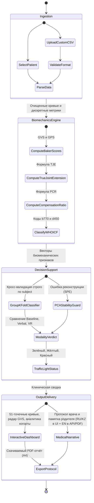

# Libra

Клиническая платформа биомеханики походки и система поддержки принятия врачебных решений (СППР) для реабилитации детей с детским церебральным параличом (ДЦП).

Разработано для **AI-Sana Shakarim Solveathon: AI & Medicine 2026** (г. Семей, область Абай).

Libra обрабатывает 3D-данные походки (дискретные параметры и 51-точечные кривые цикла шага), выявляет патологический компенсаторный наклон таза при VR-обратной связи и вербальных инструкциях, выделяет истинное разгибание тазобедренного сустава (**TJE**) и формирует врачебные и родительские отчёты с привязкой к кодам МКФ ВОЗ (**b770** и **d450**).

---

## Архитектура клинического конвейера



---

## Как работают данные и ML-модели после `git clone`

В репозиторий не зашиты бинарные веса моделей (`.pkl` / `.joblib`). Все 6 исходных CSV-файлов открытого датасета KU Leuven находятся в каталоге [`gait-cp-dataset/`](gait-cp-dataset/).

При первом запуске бэкенда ([`src/api/app.py`](src/api/app.py)) сервер автоматически:
1. Создаёт и инициализирует базу данных (SQLite `libra.db` локально или PostgreSQL в Docker).
2. Загружает все 29 участников (866 циклов `Baseline`, 870 `Verbal`, 870 `VR`) из `gait-cp-dataset/`.
3. Обучает в памяти модели `GaitConditionClassifier`, `VRResponderPredictor` и `KinematicPCAAnomalyDetector` за несколько секунд — полностью офлайн, без обращения к внешним серверам.

---

## Пошаговый запуск с нуля (чистая Windows 10/11)

Ниже приведена полная инструкция для запуска на чистом компьютере с Windows без Docker.

### Шаг 1. Установка необходимых программ

Установите три инструмента (если ещё не установлены):
1. **Git for Windows:** https://git-scm.com/download/win (оставьте настройки по умолчанию).
2. **Python 3.11 или 3.12:** https://www.python.org/downloads/windows/
   > **Важно:** на первом экране установщика обязательно поставьте галочку **"Add python.exe to PATH"**!
3. **Node.js 20 LTS (или 18+):** https://nodejs.org/ (вместе с ним автоматически установится `npm`).

Откройте **PowerShell** (или **Командную строку `cmd`**) и проверьте, что всё доступно в `PATH`:

```powershell
git --version
python --version
node --version
npm --version
```

### Шаг 2. Клонирование репозитория

```powershell
git clone https://github.com/Tamukj/Libra.git
cd Libra
```

### Шаг 3. Установка зависимостей Python и Node.js (выполняется один раз)

В **PowerShell** выполните по очереди:

```powershell
# 1. Создаём виртуальное окружение Python
python -m venv .venv

# 2. Если PowerShell запрещает запуск скриптов, разрешите локальные скрипты для текущего пользователя:
Set-ExecutionPolicy -Scope CurrentUser -ExecutionPolicy RemoteSigned -Force

# 3. Активируем виртуальное окружение (в начале строки появится (.venv))
.\.venv\Scripts\Activate.ps1

# 4. Обновляем pip и ставим бэкенд + зависимости для тестов
python -m pip install --upgrade pip
pip install -e ".[dev]"

# 5. Ставим зависимости фронтенда (Next.js)
cd web
npm install
cd ..
```

*(Если используете классическую командную строку **`cmd.exe`** вместо PowerShell, для активации окружения выполните `.\.venv\Scripts\activate.bat` вместо шагов 2–3.)*

### Шаг 4. Запуск сайта

Убедитесь, что в текущем терминале активировано `.venv` (`(.venv)` в начале строки), и запустите проект одним из способов:

- **Способ 1 (PowerShell):**
  ```powershell
  .\run_local.ps1
  ```
- **Способ 2 (`cmd.exe`):**
  ```bat
  run_local.bat
  ```
- **Способ 3 (вручную в двух окнах терминала — самый надёжный при отладке):**
  - **Окно 1 (Backend FastAPI):**
    ```powershell
    cd Libra
    .\.venv\Scripts\Activate.ps1
    python -m uvicorn src.api.app:app --host 127.0.0.1 --port 8000
    ```
  - **Окно 2 (Frontend Next.js):**
    ```powershell
    cd Libra\web
    npm run dev
    ```

После запуска откройте в браузере:
- **Веб-интерфейс:** http://127.0.0.1:3000
- **Документация REST API (Swagger):** http://127.0.0.1:8000/docs
- **Проверка готовности (Healthcheck):** http://127.0.0.1:8000/health

Для остановки серверов нажмите `Ctrl+C` (или закройте открытые окна терминала).

---

## Запуск на Linux / macOS

```bash
git clone https://github.com/Tamukj/Libra.git
cd Libra

python3 -m venv .venv
source .venv/bin/activate
pip install -e ".[dev]"

cd web && npm install && cd ..

./run_local.sh
```

Веб-интерфейс откроется на http://127.0.0.1:3000, API — на http://127.0.0.1:8000.

---

## Запуск через Docker Compose (продакшн-конфигурация)

Требуются только **Docker** и **Docker Compose** (Python и Node.js на хосте не нужны). Контейнеры автоматически поднимают PostgreSQL 16, FastAPI, Next.js и обратный прокси Caddy:

```bash
git clone https://github.com/Tamukj/Libra.git
cd Libra

# Укажите надёжный пароль БД (и при необходимости API-ключ для защищённого режима):
export POSTGRES_PASSWORD="change_me_strong_password"
# Для демо-доступа без X-API-Key в локальном Docker (для продакшна оставьте 0 и задайте LIBRA_API_KEY):
export LIBRA_ALLOW_DEMO=1

docker compose up -d --build
```

*(На Windows PowerShell вместо `export` используйте `$env:POSTGRES_PASSWORD="change_me_strong_password"` и `$env:LIBRA_ALLOW_DEMO="1"`.)*

После сборки откройте http://localhost.

---

## Запуск автотестов

Активируйте `.venv` и выполните:

```bash
python3 -m pytest tests/ -v
```

Все **58 автотестов** проверяют CSV-парсер (`;`, `,`, `NaN`, `LEFT`/`RIGHT`), биомеханические формулы (`TJE`, `PCR`, `GVS`, `GPS`, МКФ `b770`/`d450`), изоляцию ML-кросс-валидации по `subject`, защиту от ПДн (Закон РК № 94-V), генерацию PDF и контракты REST API. Тесты работают во временной изолированной БД и не затрагивают `libra.db`.

Проверка типов TypeScript на фронтенде:

```bash
cd web && npx tsc --noEmit
```

---

## Пошаговый сценарий проверки для жюри

1. **Вход в систему:** откройте http://127.0.0.1:3000 и нажмите **«Кабинет врача»** (или перейдите на http://127.0.0.1:3000/login и нажмите **«Открыть реестр пациентов»**).
2. **Реестр пациентов (`/portal`):** изучите список всех 29 обезличенных участников когорты KU Leuven, фильтры по статусам СППР (`Все`, `Риск перегрузки`, `Внимание / адаптация`, `Без перегрузки`, `Не оценено`) и откройте карту пациента.
3. **Разбор компенсации тазом (пациент `s61520_1`):** индикатор СППР загорается **красным**. Коэффициент компенсации `PCR = 1.21`: несмотря на кажущееся улучшение разгибания бедра, оно достигнуто за счёт перегрузки таза (`+5.36°` наклона), что даёт `TJE = +2.68°` и риск поясничного гиперлордоза.
4. **Разбор истинного прогресса (пациент `s61520_13`):** индикатор СППР **зелёный**. Истинное разгибание бедра без патологической компенсации тазом (`PCR < 0.40`).
5. **Сравнение условий (`Baseline`, `Verbal`, `VR`):** в блоке выбора тактики реабилитации сравниваются все три условия с указанием наиболее безопасного режима и числа учтённых циклов шага.
6. **Переключение языка:** в верхней панели переключите язык между русским (`РУС`) и казахским (`ҚАЗ`) — переводится весь интерфейс, клиническая терминология и заключения.
7. **Живая аналитика когорты:** откройте вкладку **«Аналитика когорты»** для просмотра распределений статусов СППР, оптимальных режимов, циклов шага и антропометрии из БД.
8. **Экспорт PDF-отчёта:** нажмите **«Медицинский отчёт (PDF)»**, выберите режим **Врач** или **Родитель** и язык, затем скачайте A4 PDF со сравнительной таблицей, кривой цикла шага, кодами МКФ (`b770`, `d450`), ограничениями решения и памяткой по номеру `103`.
9. **Загрузка собственных CSV и лонгитюдные визиты:** нажмите **«Загрузить CSV»** в боковой панели или **«Добавить визит»** в карте пациента. Поддерживаются шаблоны Vicon, IMU и 51-точечной кинематики, сопоставление визитов и исправление/перенос проб.

---

## Биомеханические формулы и клинические эвристики

### 1. Baker Gait Variable Score (GVS) и Gait Profile Score (GPS)

GVS оценивает среднеквадратичное отклонение кинематической кривой пациента от возрастной нормы по 51 точке цикла шага:

$$GVS_v = \sqrt{ \frac{1}{51} \sum_{t=0}^{50} \left( \theta_{patient, v}(t) - \bar{\theta}_{TD, v}(t) \right)^2 }$$

GPS объединяет показатели GVS по всем сегментам:

$$GPS = \sqrt{ \frac{1}{N_v} \sum_{v=1}^{N_v} GVS_v^2 }$$

### 2. True Joint Extension (TJE — истинное разгибание бедра)

Исключает ложное «улучшение» разгибания бедра за счёт компенсаторного переднего наклона таза ($\Delta PelvicTilt$ по кривой `aSagP`):

$$TJE = \Delta aMinSagH + \alpha \cdot \max(0, \Delta PelvicTilt)$$

Отрицательное значение `TJE` подтверждает истинный анатомический прогресс в тазобедренном суставе.

### 3. Pathological Compensation Ratio (PCR — коэффициент компенсации)

$$PCR = \frac{0.5 \cdot \max(0, \Delta GVS_P) + 0.3 \cdot \max(0, \Delta GVS_K) + 0.2 \cdot \max(0, \Delta GVS_A)}{|\Delta aMinSagH|}$$

- **Зелёный ($PCR < 0.4$):** истинный положительный отклик без перегрузки таза.
- **Жёлтый ($0.4 \le PCR \le 0.8$ или неполные данные):** умеренная адаптация, требуется наблюдение специалиста.
- **Красный ($PCR > 0.8$ или $TJE \ge 0$ с перегрузкой таза):** патологическая компенсация; рекомендация консультации лечащего врача и вызова `103` при острых симптомах.

### 4. Соответствие категориям МКФ ВОЗ

- **МКФ `b770` (Функции стереотипа походки):** `b770.0` (GPS < 5.5°), `b770.1` (5.5–7.5°), `b770.2` (7.5–11.0°), `b770.3` (11.0–15.0°), `b770.4` (≥ 15.0°).
- **МКФ `d450` (Ходьба):** определяется по доле аномальных циклов шага, выявленных кинематической моделью PCA.

---

## Протокол машинного обучения

1. **Строгая изоляция по участнику (`subject`):** используется `GroupKFold(n_splits=5)` и Leave-One-Subject-Out (`LOO`) с группировкой по `subject`. Циклы одного ребёнка никогда не попадают одновременно в обучение и проверку.
2. **Отсутствие утечки при препроцессинге:** `SimpleImputer` и `StandardScaler` обучаются строго внутри каждого фолда.
3. **Честные метрики:**
   - Бинарная классификация `Baseline` vs `VR` (1 736 циклов, 29 участников): Balanced Accuracy **70.6%**, ROC-AUC **0.772** (`Sensitivity 66.2%`, `Specificity 74.9%`).
   - 3-классовая классификация `Baseline` vs `Verbal` vs `VR` (2 606 циклов): Balanced Accuracy **51.6%** (случайное угадывание — 33.3%).
   - Дотерапевтический прогноз отклика `VRResponderPredictor` (LOO по $N=29$): Balanced Accuracy **50.5%**, ROC-AUC **0.581** — в API и UI честно выставляется флаг `model_reliable = false` (`< 0.75`), чтобы врач опирался на фактические метрики `TJE`/`PCR`.
4. **Детектор стабильности циклов (PCA SPE):** под строгим `GroupKFold(n_splits=5)` доля аномальных циклов в `Baseline` составляет **9.2%** против **27.5%** в `VR`.

---

## Справочник REST API

| Метод | Эндпоинт | Назначение |
| :--- | :--- | :--- |
| `GET` | `/health` | Проверка готовности БД и движка |
| `GET` | `/api/v1/patients` | Список пациентов с `PCR`, `TJE`, статусом, `GPS` и числом визитов |
| `GET` | `/api/v1/patients/{code}/visits` | Список визитов пациента |
| `GET` | `/api/v1/patients/{code}/analysis` | Анализ `Baseline`/`Verbal`/`VR`, дельты, `TJE`, `PCR`, МКФ и ML (`?visit=`) |
| `GET` | `/api/v1/patients/{code}/kinematics` | 51-точечные кривые таза, бедра, колена и стопы (`?visit=`) |
| `GET` | `/api/v1/patients/{code}/diff` | Сравнение сессий или визитов (`session_a`, `session_b`, `visit_a`, `visit_b`, `lang`) |
| `POST` | `/api/v1/patients/{code}/report` | Текстовый отчёт с кодами МКФ (`ru`/`kz`/`en`, `?visit=`) |
| `GET` | `/api/v1/patients/{code}/report.pdf` | Скачиваемый PDF-отчёт формата A4 (`?visit=`, `audience`, `lang`) |
| `GET` | `/api/v1/ml/metrics` | Метрики `GroupKFold`, `LOO` и важности признаков |
| `GET` | `/api/v1/analytics/cohort` | Живая агрегированная аналитика когорты из БД |
| `GET` | `/api/v1/ingest/template` | Шаблоны CSV (`format=vicon`, `imu`, `kinematics`) |
| `POST` | `/api/v1/patients/upload` | Загрузка CSV (`Baseline`/`Verbal`/`VR`) с фильтром ПДн по 94-V |
| `PATCH` / `DELETE` | `/api/v1/patients/{code}/sessions` | Переназначение, обмен или удаление ошибочно загруженной пробы |

---

## Ограничения решения (соответствие п. 8.2 Положения)

1. **Размер выборки ($N=29$):** калибровка выполнена на открытом клиническом датасете KU Leuven (29 детей со спастическим ДЦП). Для широкого клинического внедрения требуется многоцентровая валидация.
2. **Эвристический характер коэффициентов СППР:** веса `PCR` ($0.5, 0.3, 0.2$), пороги ($0.4, 0.8$) и прокси-оценка `d450` по PCA являются алгоритмическими ориентирами, а не стандартом ISO.
3. **Консультативный статус (не диагноз):** согласно п. 8.2, Libra является исключительно вспомогательной СППР. Система **не ставит диагнозы**, **не назначает лекарственные препараты** и не изменяет протокол терапии самостоятельно. При острой боли, травме или ухудшении состояния необходимо обратиться к лечащему врачу или в службу скорой медицинской помощи по номеру **103**.
4. **Нормативные кривые:** коридор нормы здоровых детей (`±1 SD`) параметризован по Schwartz et al. (2008).
5. **Режим авторизации:** при локальной разработке без `LIBRA_API_KEY` включён демо-режим (`LIBRA_ALLOW_DEMO=1`); при установке `LIBRA_API_KEY` авторизация по умолчанию переходит в строгий режим (`LIBRA_ALLOW_DEMO=0`).

---

## ИИ-инструменты, открытые данные и лицензии (п. 8.3 и 9.2)

### Использованные ИИ-инструменты
- **Claude 3.7 Sonnet (Anthropic):** проектирование архитектуры и клиническая ревизия.
- **Gemini 2.5 Pro и Gemini 4 Hydrogen (Google DeepMind):** валидация биомеханики, мультиязычное выравнивание (`ru`/`kz`/`en`), аудит безопасности и настройка Docker.

### Открытые источники данных
- **KU Leuven Pediatric Cerebral Palsy Gait Dataset** (De Mulder et al., 2024): открытый датасет 3D-анализа походки (`Baseline`, `Verbal`, `VR`). Лицензия: `CC-BY-NC-SA-4.0`, DOI: `10.48804/JUNNWW`.
- **Нормативная кинематика:** коридор нормы здоровых детей по Schwartz et al. (2008).

### Сторонние библиотеки и лицензии (п. 8.3)

| Компонент | Назначение | Лицензия |
| :--- | :--- | :--- |
| FastAPI / Starlette / Pydantic | REST API и валидация схем | MIT |
| Uvicorn | ASGI-сервер | BSD-3-Clause |
| SQLAlchemy | ORM и работа с SQLite / PostgreSQL | MIT |
| psycopg2-binary | Драйвер PostgreSQL (`docker-compose`) | LGPL-3.0 (с исключением OpenSSL) |
| pandas / NumPy / SciPy | Парсинг CSV и матричные расчёты | BSD-3-Clause |
| scikit-learn | `GroupKFold`, `LogisticRegression`, `PCA` | BSD-3-Clause |
| python-multipart | Обработка multipart-загрузки CSV | Apache-2.0 |
| Matplotlib | Построение графиков и A4 PDF-отчётов | PSF / Matplotlib License |
| Next.js / React / React DOM | Веб-интерфейс | MIT |
| TypeScript | Статическая типизация фронтенда | Apache-2.0 |
| Lucide React | Иконки интерфейса | ISC |
| Inter / Noto Serif / JetBrains Mono | Встроенные шрифты (`web/public/fonts`) | SIL Open Font License 1.1 |
| PostgreSQL | Реляционная БД в Docker Compose | PostgreSQL License |
| Caddy | Обратный прокси в Docker Compose | Apache-2.0 |
| pytest / httpx | Модульное и API-тестирование (`[dev]`) | MIT / BSD-3-Clause |
