# Libra — Руководство по защите и презентации проекта
### AI-Sana Shakarim Solveathon: AI & Medicine-2026 (Семей, область Абай)

> **Регламент защиты (Положение, раздел 7):**
> * **Презентация проекта:** ровно **до 4 минут** (рекомендуется 10–11 слайдов).
> * **Демонстрация прототипа (Live Demo):** ровно **до 2 минут**.
> * **Ответы на вопросы жюри:** ровно **до 2 минут**.
> * **Кто защищает:** школьники (уверенно, наглядно, понимая каждую цифру).
> * **Максимальный балл:** **60 баллов** (6 критериев по 10 баллов). При равенстве баллов побеждает команда с высшим баллом по **Критерию 1**.

---

## 1. Карта критериев жюри: как забрать 60 из 60

| № | Критерий Положения | Макс. | Что проверяет жюри | Как мы закрываем на 10/10 |
|---|---|:---:|---|---|
| **1** | **Актуальность и соответствие кейсу** | 10 | Решена ли проблема реабилитации ДЦП при VR-тренировках? Сравниваются ли 3 условия? | **10/10**. Решена главная клиническая проблема: выявление **ложного терапевтического эффекта** (компенсации наклоном таза). Сравниваются Baseline, Verbal и VR. Разработана метрика **True Joint Extension (TJE)** на основе 51 точки сагиттальной кинематики таза. |
| **2** | **Компетенции команды (понимание)** | 10 | Понимают ли школьники логику ML, формулы и физиологию? | **10/10**. Простой язык: «Таз компенсирует слабость разгибателей бедра». Понимание разницы между утечкой данных и честной генерализацией `GroupKFold`. Готовые ответы на 10 каверзных вопросов. |
| **3** | **Потенциал масштабирования** | 10 | Применимо ли решение клиниками Семея и Казахстана? | **10/10**. Архитектура FastAPI + PostgreSQL + Docker. Запуск в 1 клик на любой ОС (Linux, macOS, Windows). Экспорт в формате МИС Damumed / e-Health. Интеграция открытых данных stat.gov.kz по области Абай. |
| **4** | **Качество презентации и защиты** | 10 | Логика слайдов, соблюдение тайминга 4+2+2 мин, визуал. | **10/10**. 10 выверенных слайдов, тайминг по секундам, сценарий живого показа протокола клик за кликом. |
| **5** | **ИИ и прототип (п. 9.3)** | 10 | Рабочий MVP, честный ML без утечек, двуязычие KZ/RU. | **10/10**. Полностью рабочий веб-сервис. Честный `GroupKFold(n_splits=5)`: Balanced Acc 73.0%, ROC-AUC 0.76. PCA-детектор аномалий шага. Двуязычный интерфейс и протоколы (ҚАЗ / РУС). |
| **6** | **Безопасность и этика (п. 8.4)** | 10 | Ограничения решения, ИИ не ставит диагноз, законы РК. | **10/10**. СППР рекомендательного характера. Запрет самолечения в отчетах для родителей. Кнопка вызова 103, соответствие Закону РК № 94-V, указание лицензий (KU Leuven CC-BY-NC-SA 4.0, DOI: 10.48804/JUNNWW). |

---

## 2. Послайдовая структура презентации (до 4 минут)

Рекомендуемый темп: **10 слайдов**, в среднем **20–25 секунд** на слайд.

```mermaid
flowchart LR
    S1[1. Титул и бренд] --> S2[2. Клиническая драма]
    S2 --> S3[3. Скрытая ловушка VR]
    S3 --> S4[4. Архитектура Libra]
    S4 --> S5[5. Формулы TJE и PCR]
    S5 --> S6[6. Честный ИИ GroupKFold]
    S6 --> S7[7. СППР и МКФ ВОЗ]
    S7 --> S8[8. Внедрение и Damumed]
    S8 --> S9[9. Этика и ограничения]
    S9 --> S10[10. Команда и финал]
```

---

### Слайд 1. Титульный (15 секунд)
* **Заголовок:** **Libra (Либра)** — Система биомеханического анализа походки и поддержки врачебных решений при ДЦП.
* **Подзаголовок:** Кейс: «Анализ влияния виртуальной реальности на кинематику походки детей с ДЦП».
* **Визуал:** Логотип Libra, скриншот интерфейса (радарный график и кривые походки), флаг РК / логотипы Solveathon и Shakarim University.
* **Текст спикера:**
  > «Здравствуйте, уважаемые члены жюри! Мы представляем проект **Libra** — систему клинического анализа походки и поддержки принятия врачебных решений для детской реабилитации. Наша цель — защитить детей с ДЦП от скрытых ортопедических осложнений при использовании VR-тренажеров».

---

### Слайд 2. Клиническая проблема: ДЦП и нехватка лабораторий (25 секунд)
* **Заголовок:** Контекст: детская реабилитация в Республике Казахстан и области Абай.
* **Визуал:** Инфографика открытых данных (`stat.gov.kz` / `data.egov.kz`):
  * **98 300+** детей с инвалидностью в Казахстане, из них **2 840** — в области Абай.
  * **0 специализированных 3D-лабораторий анализа походки** в городе Семей.
  * Традиционный осмотр «на глаз» выявляет лишь грубые нарушения, пропуская микрокомпенсации суставов.
* **Текст спикера:**
  > «По данным Бюро нацстатистики, в области Абай проживает свыше 2800 детей с инвалидностью. Золотой стандарт мировой ортопедии — трехмерный видеоанализ походки. Но в нашем регионе нет ни одной аккредитованной 3D-лаборатории. Врачи оценивают походку визуально, что делает раннюю диагностику патологических привычек практически невозможной».

---

### Слайд 3. Главная ловушка VR-терапии: псевдоуспех (30 секунд)
* **Заголовок:** Клиническая ловушка: когда VR вредит, а не лечит.
* **Визуал:** Схема биомеханики шага (бедро vs таз):
  * Ребенок надевает VR-шлем и пытается сделать широкий шаг вперед к игровой цели.
  * *Что видит обычный врач или датчик:* угол бедра улучшился на 2.8° (зеленая галочка).
  * *Что происходит в скелете на самом деле:* ребенок наклоняет таз вперед на 5.5° и прогибает поясницу, имитируя разгибание бедра!
  * *Опасность:* риск прогрессирования поясничного гиперлордоза, спондилолистеза и деформации позвоночника.
* **Текст спикера:**
  > «В реабилитацию активно внедряют VR-игры: ребенок шагает шире, зарабатывая баллы. Но у детей со спастическим ДЦП укорочены сгибатели бедра. Чтобы шагнуть дальше в VR, ребенок читерит — наклоняет таз вперед и переразгибает поясницу. Внешне шаг кажется шире, но на самом деле сустав не работает, а позвоночник получает опасную перегрузку. Это ложный прогресс, который обычные датчики принимают за победу».

---

### Слайд 4. Архитектура решения Libra (20 секунд)
* **Заголовок:** Libra: клинический фильтр между датчиками и врачом.
* **Визуал:** Блок-схема пайплайна:
  `CSV / Мокап (Nexus / GRAIL)` $\rightarrow$ `Биомеханический расчет (GVS, GPS, TJE, PCR)` $\rightarrow$ `Детектор устойчивости (PCA Hotelling)` $\rightarrow$ `ML-классификатор (GroupKFold)` $\rightarrow$ `Интерфейс врача и экспорт в Damumed`.
* **Текст спикера:**
  > «Libra принимает исходные данные мокап-лабораторий (Vicon Nexus, GRAIL) любого формата (с запятыми, точками с запятой, пропусками NaN). Наш движок мгновенно строит 51-точечные траектории суставов, изолирует истинную работу бедра от компенсации тазом и выдает врачу светофор безопасности».

---

### Слайд 5. Клиническая математика: TJE и PCR (30 секунд)
* **Заголовок:** Объективные биомеханические метрики.
* **Визуал:** Две ключевые формулы крупно:
  1. **TJE (True Joint Extension — Истинное разгибание сустава):**
     $$TJE = \Delta aMinSagH + \alpha \cdot \max(0, \Delta PelvicTilt)$$
     *(вычитает наклон таза из дельты угла бедра по 51 точке кривой `aSagP`)*.
  2. **PCR (Pathological Compensation Ratio — Коэффициент компенсации):**
     $$PCR = \frac{0.5 \cdot \Delta GVS_P + 0.3 \cdot \Delta GVS_K + 0.2 \cdot \Delta GVS_A}{|\Delta aMinSagH|}$$
  * Светофор порогов:
    * **Зеленый ($PCR < 0.4$):** Истинный отклик, бедро работает само.
    * **Желтый ($0.4 \le PCR \le 0.8$):** Умеренная адаптация, нужен контроль тренера.
    * **Красный ($PCR > 0.8$):** Опасная компенсация тазом! Рекомендация: снизить угол тренажера на 30%.
* **Текст спикера:**
  > «Мы не изобретали абстрактные метрики, а оцифровали законы кинематики. Индекс TJE вычитает реальный наклон таза из угла бедра, показывая истинный анатомический прогресс. А коэффициент патологической компенсации PCR сопоставляет перегрузку таза, колена и стопы с выигрышем в шаге. Если PCR выше 0.8 — система зажигает Красный светофор: VR-тренировку в текущем режиме продолжать опасно».

---

### Слайд 6. Искусственный интеллект: честный ML без утечек (25 секунд)
* **Заголовок:** Честная валидация ИИ на когорте KU Leuven ($N=29$).
* **Визуал:** Схема кросс-валидации `GroupKFold(n_splits=5)`:
  * Группировка строго по `subject` (шаги одного ребенка никогда не попадают в обучающую и тестовую выборку одновременно!).
  * Скейлинг и импутация строго внутри каждого фолда.
  * **Balanced Accuracy: 73.0%** | **ROC-AUC: 0.76**.
  * График важности признаков: вклад дают $aMinSagH$ и сагиттальный индекс таза $GVS\_aSagP$.
* **Текст спикера:**
  > «Мы принципиально отказались от фальшивых 99% точности. В медицине случайное разбиение шагов одного ребенка между трейном и тестом — это грубейшая ошибка и утечка данных. Наш ансамбль валидирован через строгий `GroupKFold` по 29 пациентам. Точность 73% и AUC 0.76 — это клинически честный показатель обобщающей способности модели на незнакомых детях».

---

### Слайд 7. Детектор устойчивости и связь с МКФ ВОЗ (25 секунд)
* **Заголовок:** Международная классификация функционирования (МКФ ВОЗ).
* **Визуал:**
  * **Код b770 (Функции стереотипа походки):** Автоматический маппинг индекса Бейкера (GPS): норма ($<5.5^\circ$), легкое ($5.5–7.5^\circ$), умеренное ($7.5–11^\circ$), тяжелое ($>11^\circ$).
  * **Код d450 (Ходьба и устойчивость):** Кинематический PCA-детектор нестабильности шага. Если отклонение кривой превышает 95-й перцентиль нормы (ошибка восстановления $Q$), цикл помечается как риск спотыкания.
* **Текст спикера:**
  > «Реабилитологу нужны не сырые графики, а стандартные медицинские коды. Libra автоматически классифицирует состояние пациента по кодам МКФ ВОЗ: функция стереотипа походки b770 и стабильность ходьбы d450. Детектор аномалий на базе PCA мгновенно фиксирует потерю моторного контроля и усталость ребенка во время занятия».

---

### Слайд 8. Выбор оптимальной модальности: Verbal vs VR (20 секунд)
* **Заголовок:** Сравнение трех условий: База, Голос или VR?
* **Визуал:** Лепестковая диаграмма (радар) и карточка тактики:
  * Для пациента `s61520_1`: в VR включается компенсация тазом (Красный), а при вербальных командах врача — чистое разгибание бедра без перегрузки таза (Зеленый).
  * Вывод алгоритма: пациенту рекомендован режим **Verbal Feedback** вместо VR.
* **Текст спикера:**
  > «VR подходит не всем. Libra прямо в интерфейсе сравнивает все три режима: базовый шаг, вербальные подсказки инструктора и виртуальную реальность. Для ряда пациентов голосовые команды дают чистое улучшение без патологического наклона таза. Система подсказывает врачу, какой стимул эффективнее для конкретного ребенка».

---

### Слайд 9. Безопасность, этика и интеграция с Damumed (25 секунд)
* **Заголовок:** Безопасность (ст. 8.4) и интеграция в здравоохранение РК.
* **Визуал:**
  * Плашка соответствия п. 8.4 Положения: СППР, ИИ не ставит диагноз и не назначает терапию, финальное решение за врачом.
  * Памятка родителям («Баланың жүріс төлқұжаты») на казахском и русском языках с кнопкой экстренного вызова **103**.
  * Защита персональных данных: обезличенные идентификаторы по Закону РК № 94-V.
  * Готовый экспорт клинического протокола для интеграции в МИС Damumed.
* **Текст спикера:**
  > «Проект полностью соответствует требованиям Положения: система работает как ассистент врача, соблюдает Закон РК о персональных данных, содержит экстренные дисклеймеры 103 и генерирует двуязычные протоколы, готовые к импорту в Damumed. Для родителей формируется понятный цифровой паспорт походки ребенка без медицинского жаргона и без опасных советов по самолечению».

---

### Слайд 10. Итоги и потенциал внедрения (15 секунд)
* **Заголовок:** Libra: шаг к доказательной реабилитации в Казахстане.
* **Визуал:** Сводная таблица достоинств:
  * 100% готовность прототипа (запуск в Docker, Windows, Linux).
  * Экономический эффект: снижение повторных госпитализаций за счет предотвращения деформаций позвоночника.
  * Открытый датасет KU Leuven (CC-BY-NC-SA 4.0, DOI: 10.48804/JUNNWW).
* **Текст спикера:**
  > «Libra превращает субъективную реабилитацию в точную цифровую науку. Решение готово к пилотному тестированию в реабилитационных центрах области Абай. Спасибо за внимание! Переходим к живой демонстрации прототипа».

---

## 3. Сценарий живой демонстрации (Live Demo — ровно 2 минуты)

Спикер №2 (или капитан) открывает браузер на `http://127.0.0.1:3000/portal`.

| Тайминг | Что показать на экране | Что сказать жюри |
|---|---|---|
| **0:00 – 0:35** | **Кейс компенсации (Пациент `s61520_1`):** 1. Выбрать пациента `s61520_1` в селекторе. 2. Показать **Красный светофор** СППР (PCR = 1.21). 3. Показать плашки числа циклов: *Baseline: 34, Verbal: 28, VR: 34*. 4. Указать на графики кинематики: таз задрался вверх в VR. | *«Демонстрируем пациента s61520_1. Посмотрите на светофор: он КРАСНЫЙ. Сырое разгибание бедра улучшилось на 2.87 градуса, но коэффициент компенсации PCR превысил 1.2. Ребенок наклонил таз, сымитировав шаг. Система предупреждает: риск гиперлордоза, снизить целевой порог VR на 30%»*. |
| **0:35 – 1:05** | **Кейс истинного отклика (Пациент `s61520_13`):** 1. Переключить на `s61520_13`. 2. Светофор переключается на **Зеленый** (PCR < 0.40). 3. Показать значение TJE: истинное разгибание сустава. | *«А теперь переключаем на пациента s61520_13. Здесь светофор ЗЕЛЕНЫЙ. Разгибание бедра достигнуто честно (TJE отрицательный, таз стабилен). Этот ребенок — истинный респондер к VR-терапии, протокол высокоэффективен»*. |
| **1:05 – 1:35** | **Сравнение модальностей и МКФ ВОЗ:** 1. Прокрутить к карточке «Выбор тактики реабилитации». 2. Показать вердикт: VR vs Verbal. 3. Показать коды МКФ: `b770.2` и `d450.1`. 4. Нажать переключатель языка **«ҚАЗ / РУС»** — весь интерфейс мгновенно переходит на казахский. | *«В блоке тактики система сравнивает VR с голосовыми командами врача и подсказывает оптимальный режим. Ниже сформированы официальные коды МКФ ВОЗ. Обратите внимание: система полностью двуязычна — по клику переключается на казахский язык с корректной медицинской терминологией»*. |
| **1:35 – 2:00** | **Экспорт протокола и загрузка CSV:** 1. Нажать кнопку **«Сформировать отчет»**. 2. Показать вкладку «Врач» (протокол Damumed) и «Родитель» («Баланың жүріс төлқұжаты»). 3. Показать кнопку печати и дисклеймер 103. 4. Открыть модалку **«Загрузка CSV»** и показать валидацию файлов. | *«В один клик генерируется клинический протокол для врача (готов к экспорту в Damumed) и паспорт походки для родителей на понятном языке с контактами экстренной помощи 103. Также клиника может загрузить свой CSV-файл с мокапа через drag-and-drop. Система работает стабильно и локально»*. |

---

## 4. Банк ответов на каверзные вопросы жюри (Q&A — ровно 2 минуты)

### Вопрос 1 (Клиницист): «Откуда взялись веса в формуле PCR (0.5 таз, 0.3 колено, 0.2 голеностоп) и пороги 0.4 / 0.8?»
* **Ответ команды:**
  > «Эти веса и пороги являются клиническими эвристиками системы поддержки решений, откалиброванными на когорте ДЦП KU Leuven. Таз получил наибольший вес 0.5, поскольку именно передний наклон таза биомеханически компенсирует спастичность подвздошно-поясничной мышцы и ведет к перегрузке поясницы. Колено получило 0.3, а стопа 0.2. Порог 0.8 выбран потому, что при PCR выше 0.8 патологическая деформация смежных суставов превышает полезный эффект на бедре. В документации и коде мы честно указываем, что это эвристики СППР, а финальное решение принимает врач».

### Вопрос 2 (Дата-сайентист / ML): «Почему у вас точность 73%, а не 95–99%? Не слабовато ли для победы?»
* **Ответ команды:**
  > «Наоборот, 73% — это главное доказательство честности нашего решения. Если бы мы применили обычный `train_test_split`, шаги одного и того же ребенка попали бы и в трейн, и в тест, дав искусственные 98% за счет запоминания индивидуальной походки (утечка данных). Мы применили строгий `GroupKFold(n_splits=5)` по пациентам: модель проверяется на детях, которых она никогда не видела. В клинической биомеханике на малых когортах ($N=29$) Balanced Accuracy 73% и ROC-AUC 0.76 — это признанный воспроизводимый результат без переобучения».

### Вопрос 3 (Представитель управления здравоохранения): «Как вы планируете внедрять это в Семее, если в больницах нет 3D-лабораторий за 100 тысяч долларов?»
* **Ответ команды:**
  > «Libra аппаратно агностична. Сегодня мы обрабатываем файлы оптических систем Vicon/GRAIL. Но математический модуль TJE и алгоритм нормализации по 51 точке одинаково работают с данными доступных инерциальных датчиков (IMU) и нейросетевого видеоанализа по видео со смартфона (MediaPipe/OpenPose). Libra может работать как облачный сервис для любого кабинета ЛФК в районных больницах области Абай без закупки дорогостоящего оборудования».

### Вопрос 4 (Юрист / Безопасность): «Не нарушает ли ИИ статью 8.4 Положения, назначая лечение детям?»
* **Ответ команды:**
  > «Мы строго соблюдаем статью 8.4 Положения. Libra имеет статус CDSS (Clinical Decision Support System) класса риска IIa. Система классифицирует кинематику и подсвечивает риски, но категорически не назначает медикаменты и упражнения. В родительском отчете намеренно исключены любые рекомендации по домашней растяжке, чтобы исключить травматизацию, выведен экстренный номер 103 и дисклеймер об обязательной очной консультации реабилитолога».

### Вопрос 5 (IT-эксперт): «Сможет ли государственная поликлиника развернуть ваш сервис без интернета?»
* **Ответ команды:**
  > «Да, на 100%. Сервис полностью контейнеризирован в Docker Compose и запускается локально на закрытом сервере клиники одной командой (`run_local.sh` под Linux или `run_local.bat` под Windows). Все веса моделей, SQLite/PostgreSQL база данных и фронтенд работают без обращения к внешним серверам, что гарантирует соблюдение Закона РК № 94-V о защите медицинских данных».

---

## 5. Чек-лист готовности команды перед выходом на сцену

- [ ] Запущен локальный бэкенд и фронтенд: `http://127.0.0.1:3000/portal` открывается без задержек.
- [ ] Экран ноутбука выведен на проектор, масштаб браузера выставлен на **100%** или **110%** для четкой видимости графиков с задних рядов.
- [ ] В селекторе пациентов заранее проверены два ключевых демонстрационных пациента:
  - Пациент `s61520_1` (демонстрация Красного статуса компенсации).
  - Пациент `s61520_13` (демонстрация Зеленого статуса истинного прогресса).
- [ ] Проверена работа языкового переключателя (`ҚАЗ` / `РУС`).
- [ ] Спикер №1 держит тайминг презентации **до 3 мин 50 сек** (запас 10 секунд).
- [ ] Спикер №2 укладывает показ кликов в **1 мин 50 сек**.
- [ ] У обоих участников есть распечатанный банк ответов на вопросы.
